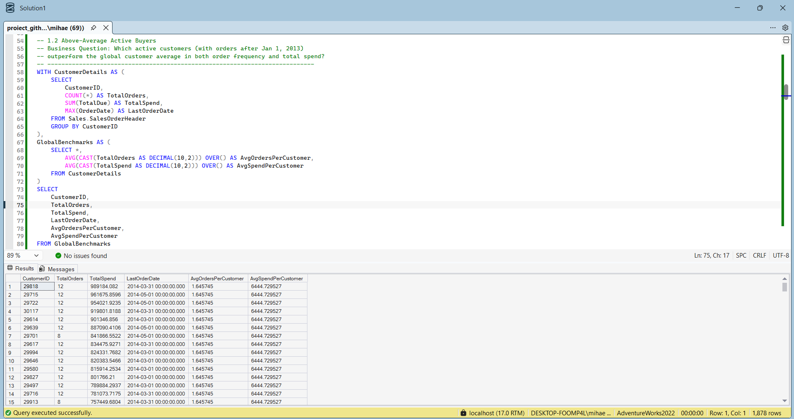
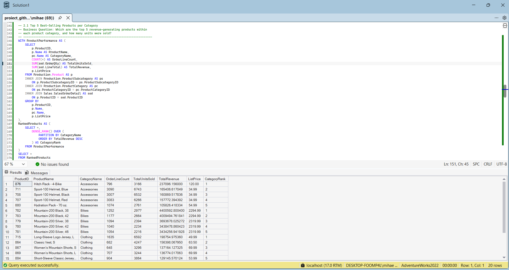
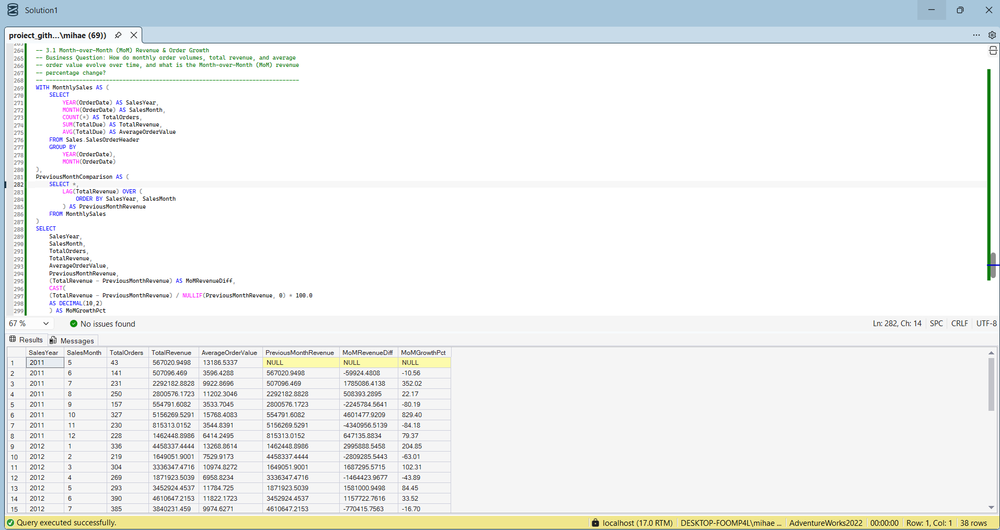

# AdventureWorks2022 – Commercial & Customer Analytics (SQL)

## Project Overview
An end-to-end **SQL data analysis portfolio project** built on the **Microsoft AdventureWorks2022** relational database using **T-SQL (SQL Server)**. Acting from the perspective of a Commercial Data Analyst, this study answers **9 core business questions** structured across three analytical chapters: **Customer Behavior & Retention**, **Product & Inventory Performance**, and **Revenue Growth & Seasonality**.

---

## Analytical Structure & Business Questions

### Chapter 1: Customer Behavior & Segmentation
* **1.1 High-Value Customer Segmentation:** Identifies repeat buyers (`>= 5 orders` and `> $10,000` total spend) along with their Average Order Value (AOV) and purchasing lifespan.
* **1.2 Above-Average Active Buyers:** Benchmarks active customers (post-2013) against global company averages for both order frequency and total spend.
* **1.3 Customer Order Progression & Cumulative Spend:** Tracks running customer spend over time and compares each order against the customer's immediately preceding order (`LAG`).
* **1.4 Order Share in Customer Lifetime Spend:** Computes the percentage weight of every single transaction within a customer's total lifetime revenue.

---

### Chapter 2: Product & Inventory Performance
* **2.1 Top 5 Best-Selling Products per Category:** Ranks the top 5 revenue-generating products within each category (*Bikes*, *Components*, *Clothing*, *Accessories*) using multi-table `JOIN`s and `DENSE_RANK()`.
* **2.2 Above-Average Category Product Density:** Isolates product categories with a broader catalog count than the overall category average.
* **2.3 Premium-Priced Items Within Subcategories:** Uses correlated subqueries to find items priced above their specific subcategory average.
* **2.4 Unsold Inventory Gap Analysis:** Performs a `LEFT JOIN` gap analysis to identify catalog items with zero sales transactions (dead stock or internal-only manufacturing components).

---

### Chapter 3: Revenue Growth & Seasonality
* **3.1 Month-over-Month (MoM) Revenue & Order Growth:** Aggregates monthly order volumes, total revenue, and AOV, calculating exact dollar differences and percentage growth vs. the prior month.

---

## Technical SQL Skills Demonstrated
* **Query Architecture:** Multi-level Common Table Expressions (`CTE`), Correlated Subqueries
* **Window Functions:** `DENSE_RANK()`, `LAG()`, `SUM() OVER()`, `AVG() OVER()`
* **Data Modeling & Filtering:** Multi-table `INNER JOIN`, `LEFT JOIN` gap analysis, `GROUP BY`, `HAVING`
* **Data Formatting & Safety:** `NULLIF()` zero-division protection, `CAST()`, `YEAR()`, `MONTH()`

---

## Files in This Repository
* `AdventureWorks_Commercial_Analytics.sql` – Complete, commented T-SQL script containing all 9 business queries.
